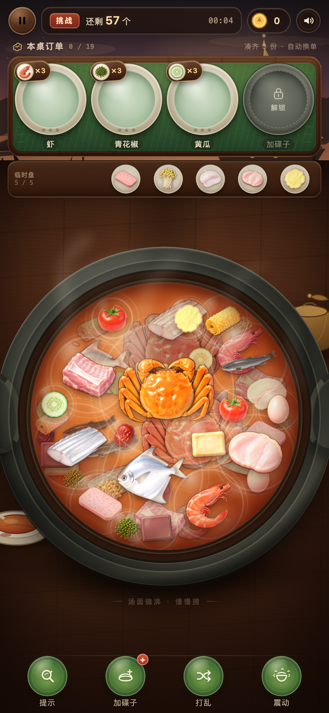

# 解压火锅店

一锅热气，慢慢捞。一个可以直接在浏览器里玩的「找食材 · 凑三份」解压小游戏。



## 怎么玩

1. 点击「开锅」开始。上方三只餐盘是本桌要捞的食材。
2. 在锅里找到同款食材并点击。每一盘需要凑齐 **3 份**。
3. 点到的不是当前订单食材时，会先放进订单和锅之间的 **5 只临时盘**；临时盘满了就放不下了。
4. 临时盘里的食材会在对应订单出现时自动补进餐盘并计分，不会浪费；因此临时盘里的份数也算在顶部“还剩”里。
5. 每只餐盘正好盛放 3 份食材：点一份就落一份，凑满后餐盘自动清空、换下一道食材，直到锅里的食材全部捞完。
6. 点上方任意餐盘，锅里的同款食材会发光 3 秒；点「提示」可以同时高亮所有当前订单。
7. 锅底一共有 **57 份、19 种食材**，每种恰好 3 份，和陆续出现的订单严格一一对应。

## 启动

直接双击 `index.html` 即可（无需构建、无需联网、无第三方依赖）。

也可以在目录里起一个静态服务：

```bash
cd hotpot-relax
python3 -m http.server 4173 --bind 127.0.0.1
```

然后打开 <http://127.0.0.1:4173/>。

## 操作与细节

- **加碟子**：把初始 3 只餐盘扩成 4 只，多一道订单同时进行；不影响食材总数。
- **打乱**：重新铺开锅里的食材，数量不变。
- **震动**：让锅和食材轻轻晃一晃，纯解压。
- **提示**：高亮当前所有订单食材，有短暂冷却。
- 点击餐盘也可以单独高亮一道食材，不限次数。
- 错误点击不会扣分，只会轻轻晃一下并给出提示。
- 支持暂停、继续、重开、静音；切到后台会自动暂停。
- 计时不设倒计时，用多久都可以。解压要紧。
- 声音包含一段轻柔的五声音阶锅物小调、捞取音效和汤底气泡声，全部由 Web Audio 实时合成。
- 首次点击「开锅」后才会播放声音；也可以提前在开始页点「点此静音」。

## 视觉与实现

- **食材**：19 种火锅食材现已换用豆包生成的 3D 卡通写实图标，包括螃蟹、鱼豆腐、红枣、姜片、鸡蛋、午餐肉、鸡排、黄豆芽、鱼片、虾、排骨、青花椒、鸭血、带鱼、响铃卷、黄瓜、泥鳅、鲳鱼、西番茄。
- **素材处理**：生成图原本是白底 JPG，通过 macOS Vision 前景分割去掉白底，统一整理成 512px 透明 PNG，放在 `assets/ingredients/`；旧版 SVG 绘制保留在 `ingredients.js` 中作兜底。
- **三层汤深**：57 份食材固定分进表层、汤中、汤底 3 层，每层 19 份，不再加载第 4 层。每层都铺满锅面，只留出食材漂移、互相碰撞的小空隙；每层里的食材都有自己的圆形碰撞体和质量。
- **不重叠优先**：为保证表层、中层、底层每一层里的食物图片都不互相压住，视觉尺寸统一收束到各自的碰撞体范围；之前几倍大的视觉倍率不再生效。现在同层食材只保留很小的漂移间隙，不同汤深之间仍允许上下遮挡。
- **水面高光**：表层每份食材周围都有一圈缓慢呼吸的双层水波纹和柔和高光，会跟着食材一起移动，用来强调“浮在汤面以上”。
- **临时盘**：订单和锅之间放了 5 只小盘，用来暂存不是当前订单的食材。每只临时盘放 1 份，最多 5 份；对应订单出现时会自动飞入订单餐盘，再计分并减少剩余份数。临时盘满了会提示并拒绝继续暂存。
- **碰撞与动量**：相碰时按圆形法线计算碰撞冲量，质量越大的食材越不容易被弹开；碰到锅壁也会因恢复系数反弹。食材只平移，不会原地自转。
- **不规则运动**：每份食材的 x、y 两个方向各有不同频率的慢速漂移，并会随机改变方向，走上下、左右和斜线，不会绕圈，也不会整齐地上下浮动。
- **点击命中**：鼠标悬停不放大、不置顶、不触发任何动画。真正的点击会按光标位置、食材的固定旋转和图片真实 alpha 像素判断是否点中，透明边缘不会误抢下层的食材；再从命中的食材中取视觉上最上面的一份执行捞取。键盘和脚本点击仍走按钮本身。
- **自动上浮**：上层食物被捞走并空出位置后，下一层的食材如果不再被上方食材压住，会自动升到上一层，同时放大、变亮。每次捞取后以及运行中都会检查补位，尽量让上层继续铺满。
- **汤面分层**：表层食材保持鲜亮原色；汤中的食材叠加暖红色汤底滤镜，汤底则红色更深、亮度更低。不是去色黑白效果，隔着锅面能清楚分辨食材在汤面以上还是以下。目标食材发光时会盖过红色滤镜，方便找到。
- **层间关系**：同层物理碰撞，不同汤深之间允许上下交错；越深的食材在视觉上越小、越暗。
- **严格的餐盘数量关系**：数据层固定每种食材 3 份，订单队列为 19 种不重复食材，每一盘正好盛放 3 份；因此总需求 57 份 = 锅内 57 份，不会出现无解或剩余。
- **餐盘会真实地装菜**：订单类型显示在小木牌上，盘内初始为空；每捞到一份，对应食材就会落入盘中的位置，装满三份后整盘换新。
- **响应式**：手机竖屏优先，兼容小屏、平板与桌面居中展示；支持安全区、减少动态偏好和键盘操作（`Esc` 暂停/继续，`M` 静音，`H` 提示）。

## 文件

```text
hotpot-relax/
├── index.html              # 页面结构与三块界面（开始 / 游戏 / 结算）
├── styles.css              # 视觉、响应式、动画
├── ingredients.js          # 食材数据（旧版 SVG 保留作兜底）
├── game.js                 # 游戏状态机、收集/换单/通关、音效与背景音乐
├── assets/ingredients/     # 19 张透明 PNG 游戏素材
├── reference/              # 豆包生成原图、参考包与提示词
└── preview-game.png        # 当前游戏画面
```

## 备注

- 背景音乐和音效依赖浏览器的 Web Audio API；Chrome、Safari、Edge、Firefox 均可。
- 若浏览器禁止自动播放声音，点击「开锅」这一下手势会正常启动音频。
- 用 `file://` 直接打开和用本地 HTTP 服务打开都可以运行。
